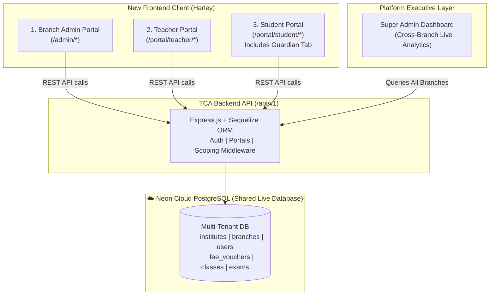
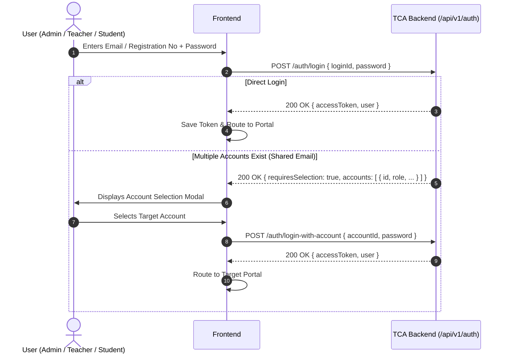

# Master Product Requirement Document (PRD)
# The Clouds Academy (TCA) — Multi-Portal Branch System (Harley Frontend)

> **Document Status:** Complete & Verified against Live Backend Schema & API Routes  
> **Target Audience:** AI Engineering Agents & Developers implementing the frontend client from scratch.  
> **Core Architecture:** 3-Portal System (Branch Admin, Teacher, Student) connecting to the live Express/Sequelize/Neon Cloud PostgreSQL backend with zero backend code changes and automatic live data synchronization with the Super Admin dashboard.

---

## 1. System Vision & Multi-Tenant Architecture



### 1.1 Active System Portals
1. **Branch Admin Portal:** Campus oversight (Admissions, Classes, Sections, Daily Attendance Register, Fees & Voucher generation/collection, Exam schedules).
2. **Teacher Portal:** Today's timetable, class attendance marking, homework/assignment publishing & grading, exam marks entry, and staff self-attendance check-in/out.
3. **Student Portal:** Personal timetable, homework submission desk, exam date-sheets, published result cards, fee dues, and a **dedicated Guardian Tab** featuring guardian information and action button.

---

## 2. Verified Backend Integration Guardrails (Anti-Conflict Rules)

These rules are reconciled directly with the live Express codebase (`src/app.js`, `src/config/cors.js`, `src/api/routes/v1/`).

### 2.1 The 7 Golden Integration Rules

| # | Integration Rule | Backend Contract Specification |
| :--- | :--- | :--- |
| **1** | **Base URL** | `http://localhost:5000/api/v1` (or `http://localhost:3000/api/v1` depending on `.env` `PORT`). |
| **2** | **CORS & Ports** | Backend pre-whitelists: `localhost:3000`, `localhost:3001`, `localhost:5173`. Run Vite on `5173` or Next.js on `3001`. |
| **3** | **withCredentials** | Always set `withCredentials: true` on Axios/Fetch instances so the `httpOnly` refresh token cookie is sent. |
| **4** | **Branch Scoping** | **Do NOT** send `X-Branch-ID` header (it is omitted from CORS allowed headers). Pass `?branch_id=<uuid>` as a query parameter on admin routes, or rely on `req.user.branch_id` auto-resolved by JWT. |
| **5** | **School Context** | Send `X-School-Code: <code_from_login>` header on all authenticated requests. |
| **6** | **Token Refresh Route** | The refresh route is `POST /api/v1/auth/refresh-token` *(NOT `/auth/refresh`)*. |
| **7** | **Account Selection Key** | When an email has multiple roles, the backend returns `{ requiresSelection: true, accounts: [...] }`. |

---

## 3. Authentication & Session Architecture

### 3.1 Role & Entry Map

| Role Identifier | `user_type` ENUM | Login Credential | Landing Route | Endpoint Used |
| :--- | :--- | :--- | :--- | :--- |
| **Branch Admin** | `BRANCH_ADMIN` | Email + Password | `/admin/dashboard` | `POST /auth/login` |
| **Teacher** | `TEACHER` | Email + Password | `/portal/teacher/dashboard` | `POST /auth/login` |
| **Student** | `STUDENT` | `registration_no` + Password | `/portal/student/dashboard` | `POST /auth/login` |

### 3.2 Login Sequence


---

## 4. Frontend Route Structure (Next.js 15 App Router)

```
src/
├── app/
│   ├── (auth)/
│   │   ├── login/page.jsx               # Branch Admin Login
│   │   ├── portal-login/page.jsx        # Teacher & Student Login (supports registration_no)
│   │   ├── forgot-password/page.jsx     # Password Reset Request
│   │   └── reset-password/page.jsx      # Set New Password
│   │
│   ├── admin/                           # Branch Admin Portal (role: BRANCH_ADMIN)
│   │   ├── layout.jsx                   # Branch Admin Shell (Sidebar + Campus Header)
│   │   ├── dashboard/page.jsx           # Branch KPIs (Students, Today's Attendance %, Fees)
│   │   ├── students/
│   │   │   ├── page.jsx                 # Student Directory & Search
│   │   │   └── new/page.jsx             # Admission Form (with Photo/Doc upload)
│   │   ├── classes/page.jsx             # Classes & Section Setup
│   │   ├── attendance/page.jsx          # Daily Attendance Register
│   │   ├── fees/
│   │   │   ├── page.jsx                 # Fee Vouchers Ledger & Filter
│   │   │   ├── generate/page.jsx        # Bulk Voucher Generation Wizard
│   │   │   └── collect/page.jsx         # Cashier Desk (Collect & Print Thermal Receipt)
│   │   ├── exams/
│   │   │   ├── page.jsx                 # Exam Schedules
│   │   │   └── [id]/marks/page.jsx      # Marks Entry Spreadsheet
│   │   ├── timetable/page.jsx           # Timetable Grid
│   │   └── settings/page.jsx            # Branch Info & Timings
│   │
│   └── portal/
│       ├── teacher/                     # Teacher Portal (role: TEACHER)
│       │   ├── layout.jsx               # Teacher Navigation Shell
│       │   ├── dashboard/page.jsx       # Today's Classes & Alerts
│       │   ├── classes/page.jsx         # Assigned Classes & Roster
│       │   ├── attendance/page.jsx      # Class Attendance Marker (P/A/L/Leave)
│       │   ├── assignments/
│       │   │   ├── page.jsx             # Assignments & Lecture Materials
│       │   │   └── [id]/submissions.jsx # Student Submissions & Grading
│       │   ├── exams/page.jsx           # Teacher Exam Marks Entry
│       │   ├── self-attendance/page.jsx # Check-In / Check-Out & History
│       │   └── leaves/page.jsx          # Apply for Leave & Balance
│       │
│       └── student/                     # Student Portal (role: STUDENT)
│           ├── layout.jsx               # Student Shell (Mobile-First)
│           ├── dashboard/page.jsx       # Today's Timetable & Urgent Deadlines
│           ├── timetable/page.jsx       # Full Weekly Timetable
│           ├── assignments/page.jsx     # Homework & File Upload Submission
│           ├── attendance/page.jsx      # Monthly Calendar Attendance %
│           ├── exams/page.jsx           # Datesheet & Result Cards
│           ├── fees/page.jsx            # Fee Dues & Downloadable Receipts
│           └── guardian/page.jsx        # Guardian Info Tab & Action Button
│
└── middleware.js                        # Auth Verification & RBAC Redirection Guard
```

---

## 5. Reconciled API Endpoint Contract Matrix

### 5.1 Authentication Module (`/api/v1/auth`)

| Method | Endpoint | Payload / Query | Response Structure (`data`) | Description |
| :--- | :--- | :--- | :--- | :--- |
| `POST` | `/auth/login` | `{ email, password }` OR `{ registration_no, password }` | `{ accessToken, user }` OR `{ requiresSelection: true, accounts: [...] }` | Direct login or account selection trigger. |
| `POST` | `/auth/login-with-account`| `{ accountId, password }` | `{ accessToken, user }` | Authenticates chosen account. |
| `POST` | `/auth/refresh-token` | Cookies (`refreshToken`) | `{ accessToken, refreshToken }` | Regenerates access token. |
| `POST` | `/auth/logout` | None (with credentials) | `{ message: "Logged out" }` | Clears refresh cookie. |
| `GET` | `/auth/me` | Bearer Token | `{ user: { id, user_type, first_name, permissions, school_id, branch_id, ... } }` | Session user details. |
| `POST` | `/auth/forgot-password`| `{ email }` | `{ message: "Password reset email sent" }` | Forgot password trigger. |
| `POST` | `/auth/reset-password` | `{ token, newPassword }` | `{ message: "Password updated successfully" }` | Sets new password. |

### 5.2 Branch Admin Endpoints (`/api/v1/*`)

| Method | Endpoint | Query / Payload | Description |
| :--- | :--- | :--- | :--- |
| `GET` | `/dashboard` | `?branch_id=xxx` | Total students, fees summary, attendance stats. |
| `GET` | `/students` | `?branch_id=xxx&page=1&limit=20&class_id=yyy&search=zzz` | Paginated branch student roster. |
| `POST` | `/students` | `FormData` (`photo`, `documents`, student details JSON) | New student admission. |
| `GET` | `/classes` | `?branch_id=xxx` | List classes, sections, and class teachers. |
| `POST` | `/classes` | `{ name, grade_level, branch_id }` | Create new academic class. |
| `POST` | `/classes/:classId/sections` | `{ name, capacity, room_number, section_teacher_id }` | Add section to class. |
| `GET` | `/attendance` | `?branch_id=xxx&date=YYYY-MM-DD&class_id=yyy` | Fetch branch attendance records. |
| `POST` | `/attendance/bulk` | `{ date, records: [{ student_id, status, remarks }] }` | Bulk mark daily attendance. |
| `GET` | `/fee-vouchers` | `?branch_id=xxx&status=unpaid&period_month=MM&period_year=YYYY` | Filter fee vouchers. |
| `POST` | `/fee-vouchers/generate-bulk` | `{ branch_id, academic_year_id, fee_template_id, month, year, due_date }` | Bulk generate student vouchers. |
| `PATCH`| `/fees/vouchers/:id/collect` | `{ amount, payment_method: "CASH"\|"BANK_TRANSFER", receipt_no }` | Collect payment at cashier desk. |
| `GET` | `/exams` | `?branch_id=xxx` | List branch scheduled examinations. |
| `POST` | `/exams/:id/results` | `{ student_id, marks_obtained, is_present, remarks }` | Save exam results. |
| `GET` | `/timetable` | `?branch_id=xxx` | Class & teacher weekly timetables. |

### 5.3 Teacher Portal Endpoints (`/api/v1/portal/teacher/*`)

| Method | Endpoint | Query / Payload | Description |
| :--- | :--- | :--- | :--- |
| `GET` | `/portal/teacher/dashboard` | None | Assigned classes, student count, schedule. |
| `GET` | `/portal/teacher/classes` | None | List of teacher's assigned classes & sections. |
| `POST` | `/portal/teacher/attendance/mark` | `{ class_id, section_id, date, records: [{ student_id, status, remarks }] }` | Mark student attendance. |
| `GET` | `/portal/teacher/attendance/class/:classId` | `?date=YYYY-MM-DD` | View marked class attendance. |
| `GET` | `/portal/teacher/assignments` | `?class_id=xxx` | Teacher's published assignments & notes. |
| `POST` | `/portal/teacher/assignments` | `FormData` (title, instructions, due_date, `attachments`, `files`) | Create homework or study material. |
| `GET` | `/portal/teacher/assignments/:id/submissions` | None | List student submissions. |
| `POST` | `/portal/teacher/submissions/:id/grade` | `{ marks, grade, feedback }` | Grade student submission. |
| `GET` | `/portal/teacher/exams` | None | Assigned exams. |
| `GET` | `/portal/teacher/exams/:examId/entry-students` | None | Student roster for exam marks entry. |
| `POST` | `/portal/teacher/exams/:examId/results` | `{ results: [{ student_id, marks_obtained, is_present, remarks }] }` | Bulk save exam marks. |
| `GET` | `/portal/teacher/self-attendance/today` | None | Teacher's check-in status today. |
| `POST` | `/portal/teacher/self-attendance/check-in` | None | Biometric/Manual self check-in. |
| `POST` | `/portal/teacher/self-attendance/check-out` | None | Self check-out. |
| `GET` | `/portal/teacher/leave-balance` | None | Remaining casual / sick leave quotas. |
| `POST` | `/portal/teacher/leave-requests` | `{ leave_type_id, start_date, end_date, reason }` | Apply for teacher leave. |
| `GET` | `/portal/teacher/payroll` | None | Teacher's monthly payslips. |

### 5.4 Student Portal Endpoints (`/api/v1/portal/student/*`)

| Method | Endpoint | Query / Payload | Description |
| :--- | :--- | :--- | :--- |
| `GET` | `/portal/student/dashboard` | None | Quick stats, today's classes, notices. |
| `GET` | `/portal/student/profile` | None | Student personal profile, including guardian info (`details.studentDetails`). |
| `GET` | `/portal/student/timetable` | None | Student's weekly class timetable. |
| `GET` | `/portal/student/today-classes` | None | Immediate schedule for today. |
| `GET` | `/portal/student/attendance` | `?month=MM&year=YYYY` | Monthly attendance calendar & %. |
| `GET` | `/portal/student/assignments` | None | Active & past homework. |
| `GET` | `/portal/student/assignments/upcoming` | None | Urgent assignments nearing deadline. |
| `POST` | `/portal/student/assignments/:id/submit` | `FormData` (Field: `'files'`, max 5 items, `submission_text`) | Upload homework submission. |
| `GET` | `/portal/student/exams/schedule` | None | Datesheet and exam timetable. |
| `GET` | `/portal/student/results` | None | Published term result cards. |
| `GET` | `/portal/student/fees` | None | Outstanding and paid fee vouchers. |
| `GET` | `/portal/student/fees/summary` | None | Fee balances and due dates. |
| `GET` | `/portal/student/library` | None | Digital learning resources. |
| `POST` | `/portal/student/leave-requests` | `{ leave_type_id, start_date, end_date, reason }` | Submit leave application. |

---

## 6. Key UI Modules & User Workflows

### 6.1 Student Portal: Guardian Tab & Action Button
- **Location:** Dedicated route `/portal/student/guardian` or a prominent tab inside the Student Portal.
- **Components:**
  - Guardian Information Card (Father/Guardian Name, Contact, Relation, CNIC/ID).
  - Prominent **Guardian Action Button** configured to trigger the required guardian workflow or interaction.

### 6.2 3-Part Bank Voucher & Thermal Receipt Layouts (Branch Admin)
- **3-Part Bank Voucher:** Standard A4 printable voucher containing Bank Copy, Institute Copy, and Student Copy with `@media print`.
- **Thermal POS Format:** 80mm cash receipt generated at `/fees/vouchers/:id/collect` for cash desk payments.

---

## 7. Frontend Technical Stack & State Architecture

### 7.1 Recommended Stack
- **Framework:** Next.js 15 (App Router) or React 19 + Vite.
- **Styling & Components:** Tailwind CSS + **shadcn/ui** (Dialog, DropdownMenu, Tabs, Table, Toast, Badge).
- **Icons:** `lucide-react`.
- **Client State:** `zustand` (stores `accessToken`, `user`, `activeBranchId`).
- **Server Cache:** `@tanstack/react-query` v5 (`staleTime: 5 * 60 * 1000` to prevent rate limit spikes).
- **Form Handling:** `react-hook-form` with `@hookform/resolvers/zod`.
- **Printing:** Standard CSS print media queries (`@media print`).

### 7.2 Axios Interceptor Contract (`src/lib/api.ts`)
```typescript
import axios from 'axios';
import { useAuthStore } from '@/store/authStore';

const api = axios.create({
  baseURL: process.env.NEXT_PUBLIC_API_URL || 'http://localhost:5000/api/v1',
  withCredentials: true,
  headers: {
    'Content-Type': 'application/json',
  },
});

api.interceptors.request.use((config) => {
  const { accessToken, schoolCode } = useAuthStore.getState();

  if (accessToken) {
    config.headers.Authorization = `Bearer ${accessToken}`;
  }
  if (schoolCode) {
    config.headers['X-School-Code'] = schoolCode;
  }
  if (config.data instanceof FormData) {
    delete config.headers['Content-Type'];
  }
  return config;
});

api.interceptors.response.use(
  (response) => response.data,
  async (error) => {
    const originalRequest = error.config;
    if (error.response?.status === 401 && !originalRequest._retry) {
      originalRequest._retry = true;
      try {
        const refreshRes = await axios.post(
          `${api.defaults.baseURL}/auth/refresh-token`,
          {},
          { withCredentials: true }
        );
        const newAccessToken = refreshRes.data.data.accessToken;
        useAuthStore.getState().setAccessToken(newAccessToken);
        originalRequest.headers.Authorization = `Bearer ${newAccessToken}`;
        return api(originalRequest);
      } catch (refreshErr) {
        useAuthStore.getState().logout();
        window.location.href = '/login';
        return Promise.reject(refreshErr);
      }
    }
    return Promise.reject(error.response?.data || error);
  }
);

export default api;
```

---

## 8. Definition of Done (DoD) & Acceptance Verification

1. **Active Portals Only:** The application strictly implements the 3 portals (Branch Admin, Teacher, Student).
2. **Student Portal Guardian Tab:** Guardian information and action button render cleanly inside the Student Portal.
3. **Super Admin Live Sync:** Every student admission, fee voucher collected, or attendance marked in this branch client updates the shared Neon PostgreSQL database and immediately reflects in the Super Admin dashboard.
4. **Zero Backend Changes:** Works directly against the existing `/api/v1` backend without modifying any backend code or database schemas.
